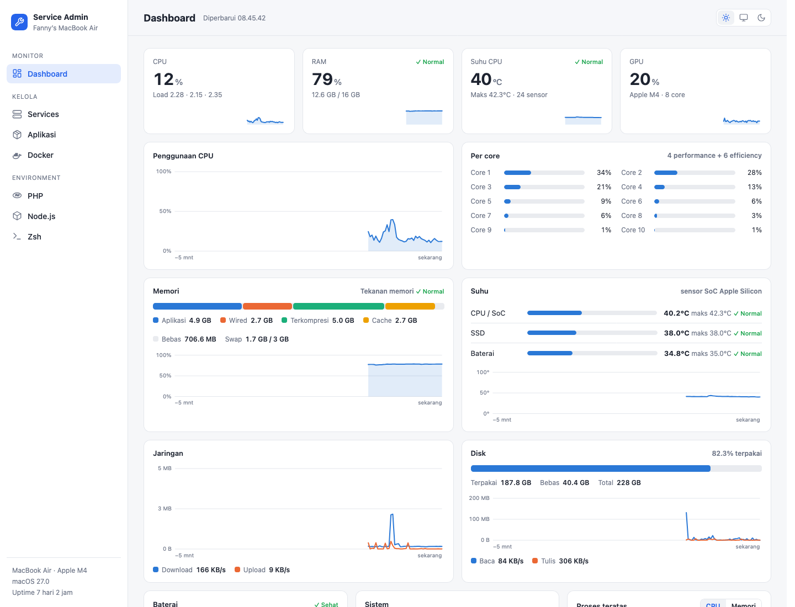

# Service Admin

**English** · [Русский](README.ru.md)

A local web panel that prepares and manages a whole Mac for development — from a freshly installed macOS —
and lets AI agents (Claude Code, Codex, …) work on the machine **only through approved, audited plans**.

* **No dependencies.** Python standard library on the back end, vanilla JS on the front end. No `pip install`, no `npm install`.
  A private Python 3.12 is downloaded by the installer, so nothing is needed on a clean Mac.
* **Local only.** Listens on `127.0.0.1`; every POST needs a header; commands run as argument lists, never through a shell.
* **Apple Silicon**, macOS 13+. UI languages: Russian (default) and English.



## What it does

| Area | Features |
|---|---|
| **System setup** | One page installs what the panel needs: Command Line Tools (Apple's own dialog), Homebrew, Git. Installation profiles (Foundation, AI, Flutter, iOS, Backend) with before/after snapshots |
| **Services & tools** | Homebrew packages and `brew services`, Docker/OrbStack, Laravel Herd, language versions (PHP, Node, Python, Go, Rust, Java, Ruby), config files with validation and backup |
| **Dashboard** | CPU per core, RAM, temperatures, GPU, battery, disk — read without `sudo` |
| **Terminal** | A real PTY terminal in the browser (Claude Code, vim, htop work normally) |
| **Projects** | Git repos: status, branches, worktrees, safe write operations; test/build presets with history; GitHub Actions |
| **Mobile** | Xcode & simulators, Flutter/FVM, Android SDK, CocoaPods |
| **Backups** | `git bundle` of your repos and data folders to a local folder or external disk, verified, scheduled, restore only into a new folder |
| **VMs & CI runners** | [tart](https://tart.run) VMs; disposable **ephemeral CI runners** (Gitea/Forgejo, GitHub) in a throw-away VM with network isolation |
| **AI agents** | Agent Control API over MCP: levels L1–L3, plans that a human approves in a macOS dialog, limits, time budget, audit with the initiator |
| **Audit** | Every action is logged (secrets masked) with who started it: `panel`, `agent:<name>` or `system:<what>` |

## Install

```bash
git clone https://github.com/LavTeamProject/DevBoxAdmin.git ~/service-admin
cd ~/service-admin
./install.sh
```

The installer downloads a checksum-verified Python 3.12, builds `Service Admin.app` (no Command Line Tools needed),
registers a LaunchAgent and starts the panel at **http://127.0.0.1:8765**.
Step-by-step guide with screenshots (verified on a clean macOS VM): [`manuals/install-clean-mac.md`](manuals/install-clean-mac.md).
Run without installing: `python3 server.py` (Python 3.11+).

## Guides

* [`manuals/install-clean-mac.md`](manuals/install-clean-mac.md) — install on a clean Mac (Russian)
* [`manuals/connect-ai-agent.md`](manuals/connect-ai-agent.md) — connect an AI agent over MCP (Russian)
* [`manuals/ci-runners.md`](manuals/ci-runners.md) — disposable CI runners in VMs (Russian)
* [`docs/roadmap.md`](docs/roadmap.md) — what is done, what is verified, what is not
* [`docs/unverified.md`](docs/unverified.md) — honest list of things that were *not* verified on real systems

## Security model

* The panel is bound to localhost. Do not expose it to a network; use an SSH tunnel if you need remote access.
* AI agents get no shell. They call a fixed set of tools; every change is a **plan** that you approve in a native macOS dialog
  (default button: Reject, 110 s timeout = reject). Level L3 (CI runners) always requires the dialog.
* A CI runner executes workflow code. **Do not connect a public repository that accepts pull requests from strangers.**
  The runner is single-use, in a disposable VM with network isolation, but the job's own secrets are visible to that code.
* Remote Docker contexts are refused for catalog and agent operations.

## Status

Verified on a real Mac, in clean macOS VMs (tart) and against a throw-away Gitea 28. **Not verified:** GitHub Actions runners,
Codex/OpenCode/Gemini as MCP clients, an Xcode VM image — see [`docs/unverified.md`](docs/unverified.md).

## Credits

* [xterm.js](https://github.com/xtermjs/xterm.js) (MIT) — terminal in the browser
* [Simple Icons](https://simpleicons.org) (CC0) — language and tool logos

## License

MIT — see [LICENSE](LICENSE). Bugs: use **Report a problem** in the panel (it opens a pre-filled GitHub issue; nothing is sent automatically) or open an issue.
