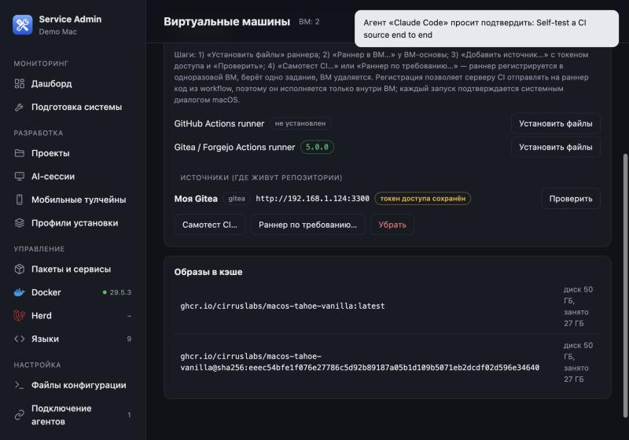
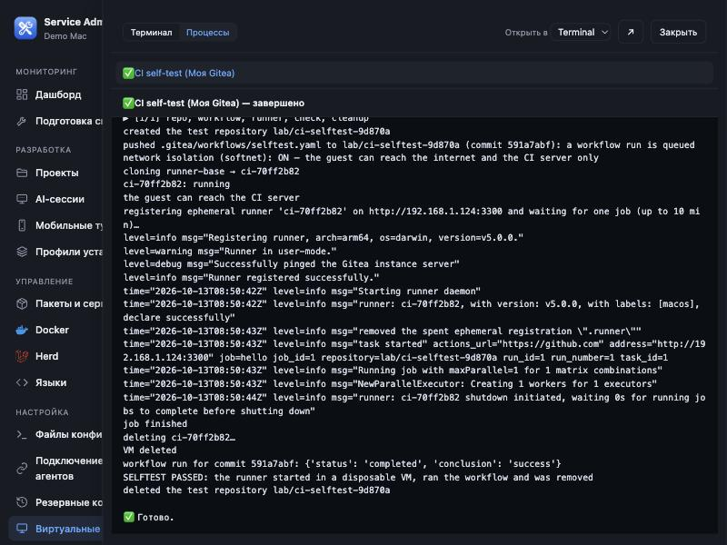

# CI-раннеры по требованию: руководство

Что умеет панель: поднять **одноразовую виртуальную машину (ВМ)**, зарегистрировать в ней **раннер** вашей CI-системы (Gitea/Forgejo или
GitHub), выполнить **одно задание** и удалить ВМ. Код из workflow исполняется только в ВМ, а не на вашем Mac. Страница: **«Виртуальные
машины»** (`#vms`). Всё делается через панель; руками нужно создать **один токен доступа** на сервере CI.

> Если что-то не получается — раздел «Если что-то пошло не так» в конце.

---

## 0. Что нужно на Mac (один раз)

| Что | Зачем | Как поставить |
|---|---|---|
| **tart** | запускает ВМ | см. `docs/roadmap.md` («Проверка на чистой macOS»): официальный `tart.tar.gz` с GitHub, в `~/.local/opt/tart`, симлинк в `~/.local/bin` (без sudo) |
| **sshpass** | панель заходит в ВМ по SSH | `brew install sshpass` |
| образ ВМ-основы | из него клонируются одноразовые ВМ | на странице ВМ: «Скачать образ…» (`ghcr.io/cirruslabs/macos-tahoe-vanilla:latest`, ~25 ГБ) → «Копия…» → дальше пункт 1 |
| **softnet** (желательно) | изоляция сети ВМ: она видит интернет и ваш сервер CI, но **не** остальные устройства вашей сети | см. ниже |

**Установка softnet** (нужен пароль администратора один раз):
```bash
# 1) скачать и положить в ~/.local/bin (панель сама ищет там; sha256 берите из страницы релиза)
curl -fsSL -o /tmp/softnet.tar.gz https://github.com/cirruslabs/softnet/releases/download/0.24.1/softnet.tar.gz
echo "8ff8ff099c2b5ac1b1128e7999c4a730ac85f486c8a4cb0239eb98432859a0f7  /tmp/softnet.tar.gz" | shasum -a 256 -c
tar -xzf /tmp/softnet.tar.gz -C /tmp softnet && mkdir -p ~/.local/bin && cp /tmp/softnet ~/.local/bin/softnet && chmod 755 ~/.local/bin/softnet
# 2) права root (SUID) — единственное, что требует пароля
sudo chown root:wheel ~/.local/bin/softnet
sudo chmod u+s ~/.local/bin/softnet
ls -l ~/.local/bin/softnet     # должно быть: -rwsr-xr-x  root  wheel
```
Без softnet всё работает, но в журнале будет предупреждение «network isolation is OFF — the guest can reach your local network».
Откат: `sudo chmod u-s ~/.local/bin/softnet` или `rm ~/.local/bin/softnet`.

⚠️ **Если на Mac включён VPN** с маршрутом по умолчанию, у ВМ может не быть интернета (локальная сеть работает). Для workflow, которым нужен
интернет, отключайте VPN на время запуска.

---

## 1. ВМ-основа с раннером

1. **«Установить файлы»** у нужного провайдера (блок «CI-раннеры»): скачается официальный раннер, сверится sha256.
   Gitea/Forgejo — `gitea-runner` (~18 МБ), GitHub — `actions/runner` (~130 МБ).
2. Остановите ВМ-основу (если запущена), у неё нажмите **«Раннер в ВМ…»** → провайдер. Файлы копируются по SSH и сверяются по sha256 каждого файла.
3. Если workflow используют `actions/checkout` или Node-действия — в основе должны быть **git** и **Node**. В образе `vanilla` их нет; после установки
   Command Line Tools в ВМ есть git, Node кладётся из официального архива в `/usr/local` (так сделана ВМ `runner-base`). Для простых `run:`-шагов не нужно.

Основу делайте **один раз**: каждый запуск раннера делает её **копию**, а основа не меняется.

---

## 2. Токен доступа на сервере CI (единственный ручной шаг)

Токен даёт панели право: получать регистрационные токены раннеров, удалять брошенные раннеры и (для самотеста) создавать/удалять **свой**
тестовый репозиторий. Токен хранится в файле `~/.service-admin/runner-tokens/<id>.token` (права 0600), обратно в интерфейсе **не показывается**,
в аудит и журналы **не попадает**.

### Gitea / Forgejo
1. Откройте Gitea → аватар → **Settings → Applications → Generate New Token**.
2. Имя: `service-admin`. Права (scopes):
   * область **«организация»** (рекомендуется): `write:repository`, `write:organization`, `write:user`;
   * область **«весь сервер»** (instance): то же + `write:admin`, а токен должен принадлежать **администратору** Gitea.
3. Нажмите «Generate token» и сразу скопируйте (потом он не показывается).
4. В Gitea должны быть включены **Actions** (`app.ini` → `[actions]` → `ENABLED = true`).

### GitHub (код написан по документации API, **не проверен на настоящем GitHub**)
1. Settings → Developer settings → Personal access tokens (classic) → Generate: scope **`repo`** (для организации ещё **`admin:org`**).
2. Область «весь сервер» (instance) на GitHub не поддерживается: используйте организацию или репозиторий.

Токен не присылайте в чат и не вставляйте в чужие программы: он вводится **только в панель**.

---

## 3. Добавить источник в панель

Блок «CI-раннеры» → **«Добавить источник…»**, по запросам:




| Вопрос | Что ввести |
|---|---|
| система CI | `gitea` (Gitea и Forgejo) или `github` |
| адрес сервера | `https://git.example.com` — **IP или имя**, без логина и параметров. `http://` с токеном доступа допускается только для локальных адресов (192.168.x.x, `*.local`, имя без точки) |
| область | `instance` (весь сервер), `org` (организация) или `repo` (один репозиторий) |
| путь | пусто для `instance`; имя организации для `org`; `владелец/репозиторий` для `repo` |
| название | любое, например `Lab` |
| тип токена | **`api`** (токен доступа, рекомендуется: панель сама получает регистрационные токены и чистит за собой) или `registration` (готовый регистрационный токен — только запуск раннера, без самотеста и без удаления брошенного раннера) |
| токен | вставьте скопированный |

Нажмите у источника **«Проверить»**: «Подключение работает: пользователь …, раннеров на сервере: N» — значит, токен принят и прав достаточно.
Типичные ошибки: *«token lacks the required scope»* — не хватает прав токена; *«not found»* — неверный адрес/путь/область; *«server redirected»* — укажите конечный адрес
(обычно `https://…`).

---

## 4. Самотест — проверить всю цепочку одной кнопкой

У источника с токеном `api` и областью `instance` или `org`: **«Самотест CI…»** → ВМ-основа → введите название источника для подтверждения.

Панель сама:
1. создаёт на сервере тестовый репозиторий `ci-selftest-xxxxxx` (у вас — для instance, в организации — для org);
2. кладёт в него workflow, который печатает `uname`, версии `node`/`git` и `selftest-ok`;
3. клонирует ВМ-основу, запускает её с сетевой изоляцией, регистрирует раннер (`--ephemeral`, одно задание);
4. находит запуск **именно для своего коммита** и проверяет `success`;
5. удаляет ВМ, брошенный раннер и тестовый репозиторий.

Перед запуском появится **системный диалог macOS** — нажмите «Одобрить» (это защита от того, чтобы программа на вашем Mac запустила CI без вас).
Успех — журнал заканчивается строкой **`SELFTEST PASSED`**. Журнал виден в панели «Процессы» (значок терминала в шапке):



В журнале видно: создан тестовый репозиторий, отправлен workflow, **сетевая изоляция включена**, ВМ-клон `ci-…` запущена, раннер зарегистрирован как временный,
задание выполнено, ВМ удалена, результат запуска — `success`, тестовый репозиторий удалён. Если репозиторий не удалился (нет права `delete`), в журнале будет `NOTE: … delete it by hand`.

Область `repo` для самотеста не подходит: он ничего не коммитит в ваш настоящий репозиторий. Для `repo` используйте «Раннер по требованию…».

---

## 5. Раннер по требованию для настоящей работы

У источника **«Раннер по требованию…»** → ВМ-основа → сколько минут ждать задание (1–240) → название источника → **системный диалог macOS «Одобрить»**. Дальше:

1. ВМ клонируется и запускается, гость проверяет, что видит сервер CI (иначе job сразу падает с понятной ошибкой);
2. раннер регистрируется как `ci-xxxxxxxx` с меткой **`macos:host`** (Gitea) — в workflow пишите `runs-on: macos`;
   для GitHub метки стандартные: `runs-on: [self-hosted, macOS]`;
3. ждёт **одно** задание (сделайте push — или оно уже в очереди);
4. после задания (или по истечении времени) ВМ удаляется; брошенный раннер удаляется с сервера (источник `api`).

Один запуск = одно задание = одна ВМ. Для постоянной работы запускайте кнопку (или агента) под каждую нужную сборку.

---

## 6. Работа через ИИ-агента

Агент (Claude Code, Codex, …) подключается к панели по MCP (страница «Подключение агентов»). Для операций CI агенту нужен **уровень L3** — его
выдаёте **вы** в таблице агентов (панель переспросит). Что агент может на уровне L3:

* читать: `list_ci_sources` (источники **без токенов**), `list_vms`, `inspect_system`, …;
* **предлагать** операции `runner.spawn` и `runner.selftest` через `plan_changes` (параметры: `source` — id из `list_ci_sources`, `vm` — основа,
  `confirm` — точное название источника, `minutes`, при желании `isolate`).

**Агент не может выполнить ничего сам:** после `plan_changes` вы в панели («Подключение агентов» → очередь запросов) нажимаете **«Одобрить»** — появляется
**системный диалог macOS** с предупреждением «ВНИМАНИЕ, уровень L3…», названием источника, адресом сервера и ВМ. Только после вашего «Одобрить» агент
вызывает `execute_plan`, следит за `get_job_status` и проверяет `verify_plan`. «Не спрашивать» для L3 **невозможно** — даже режим «кнопка в панели» на L3 не действует. Лимиты: 6 предложений и 3 исполнения CI в час на агента.
Токенов (ни доступа, ни регистрационных) агент **не видит** и не может ввести: источник и токен добавляете вы.

Пример запроса агенту: «Запусти самотест CI: найди источник и остановленную ВМ-основу, предложи план `runner.selftest` и скажи мне его id».

---

## 7. Безопасность — что важно понимать

* Регистрация раннера даёт серверу CI право присылать на раннер **код из workflow**. Он исполняется **внутри одноразовой ВМ**; поэтому для чужих и
  недоверенных репозиториев используйте только этот режим, а не раннер прямо на Mac.
* **Не подключайте публичный репозиторий, куда принимают pull request от посторонних** (и вообще репозитории, чей код вы не доверяете): workflow из такого PR выполнится на вашем раннере и увидит токены и секреты задания. Одноразовая ВМ и softnet ограничивают ущерб хосту и локальной сети, но не секреты самого задания. Это же рекомендует и GitHub для self-hosted раннеров на публичных репозиториях.
* Гость видит интернет и **разрешённые адреса сервера CI**; остальная локальная сеть недоступна (при включённом softnet). Без softnet — доступна.
* Токен доступа может многое (создавать репозитории, управлять раннерами): дайте **минимальные** права и отзовите токен на сервере CI, если он больше не нужен.
  «Убрать» источник в панели удаляет сохранённый токен с Mac.
* Всё действия пишутся в аудит (`#audit`) без секретов.

---

## 8. Если что-то пошло не так

| Симптом | Что проверить |
|---|---|
| «Установить файлы» не качает | интернет на **хосте**; место на диске (нужно ≥ 5 ГБ) |
| `Раннер в ВМ…`: «the VM did not accept SSH in 2 minutes» | установлен ли `sshpass`; в образе ВМ включён SSH и пароль учётки `admin` — `admin` (образы cirruslabs) |
| «the guest cannot reach the CI server» | гость не видит сервер: проверьте адрес; VPN на хосте (отключите); при softnet сервер должен быть доступен по адресу, который резолвит **хост** (при `isolate=false` изоляция выключается) |
| «Проверить»: «token lacks the required scope» | пересоздайте токен с нужными правами (раздел 2) |
| самотест: `runner.selftest_scope` | выберите источник с областью `instance` или `org` |
| «Runner … cannot register» / регистрация падает | Actions выключены на сервере; неверный токен; для GitHub — нет прав `admin:org` |
| раннер остался «офлайн» на сервере | источник с типом токена `registration` — удалите раннер на сервере вручную (с `api` панель удаляет сама) |
| ВМ `ci-…` осталась после сбоя | страница ВМ → «Остановить», «Удалить…» (введите имя); панель в норме удаляет их сама |
| в журнале «network isolation is OFF» | `softnet` не установлен или без SUID (раздел 0) |

Подробности реализации и проверок — `docs/roadmap.md` (Фаза 5), список непроверенного — `docs/unverified.md`, чек-лист — `docs/checklist.md`; установка с нуля — `manuals/install-clean-mac.md`.
