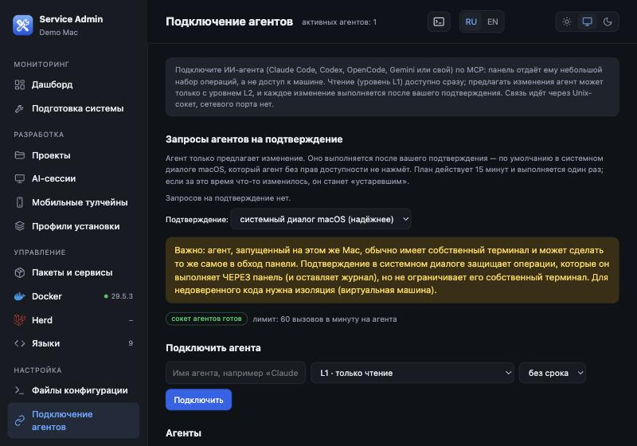
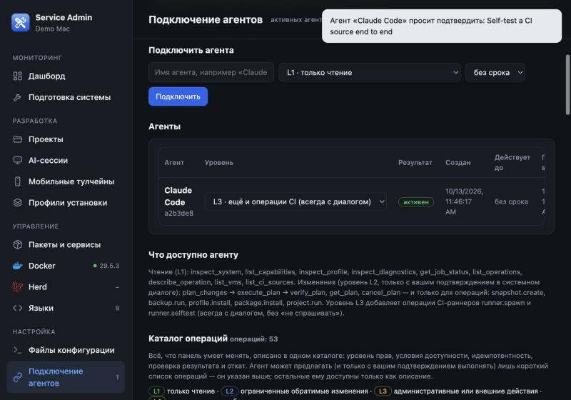
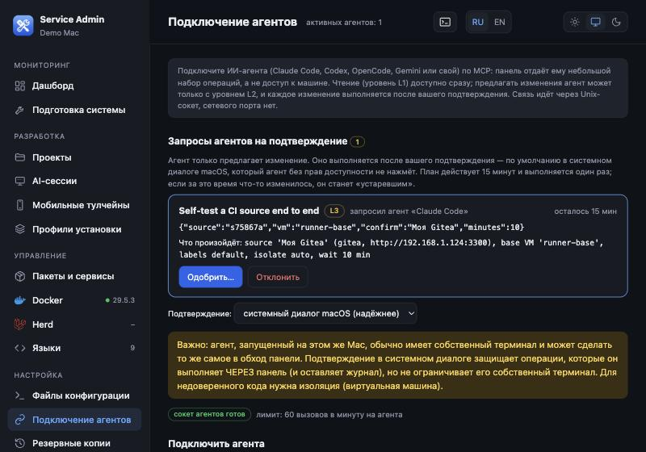
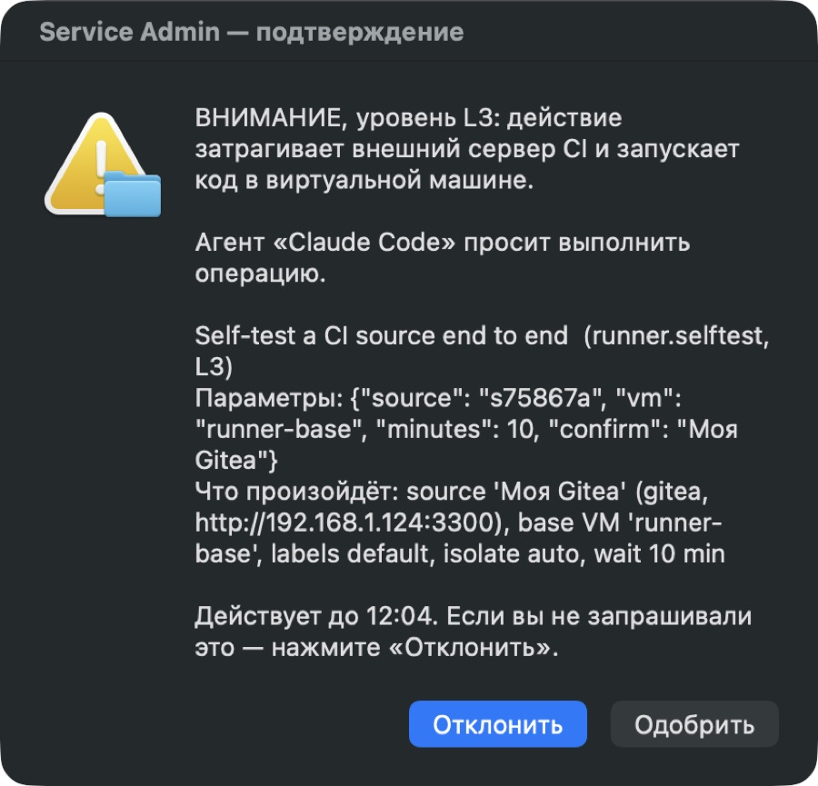

# Подключение ИИ-агента к панели (MCP)

Панель отдаёт агенту (Claude Code, Codex, OpenCode, Gemini или свой) **небольшой набор операций**, а не доступ к машине. Связь идёт по Unix-сокету
`~/.service-admin/agent.sock` (права 0600) — сетевого порта нет. Инструмента «выполнить команду» (`execute_shell`) **не существует**.

> Проверено с настоящим **Claude Code 2.1.236**. Codex, OpenCode и Gemini по этой же схеме должны работать (MCP stdio), но **не проверялись** —
> см. `docs/unverified.md`.

## Уровни агента (их выдаёте вы, не агент)

| Уровень | Что может агент |
|---|---|
| **L1 — только чтение** | `inspect_system`, `inspect_diagnostics`, `inspect_profile`, `list_capabilities`, `list_operations`, `describe_operation`, `list_vms`, `list_ci_sources`, `list_containers` (контейнеры локального Docker) (без токенов), `get_job_status`. Инструментов записи он **не видит** |
| **L2 — предлагает изменения** | всё из L1 + `plan_changes`, `get_plan`, `execute_plan`, `cancel_plan`, `verify_plan`, `cancel_job` (останавливает только задачу из собственного плана агента) для 6 операций: снимок окружения, резервная копия, установка профиля, установка пакета, тест/сборка проекта, запуск/остановка/перезапуск контейнера Docker (`docker.container_control`; только локальный Docker — при удалённом контексте отказ) |
| **L3 — ещё и операции CI** | всё из L2 + `runner.spawn`, `runner.selftest` (раннер в одноразовой ВМ). Выдаётся с предупреждением; **подтверждение всегда в системном диалоге**, «не спрашивать» невозможно |

**Любое изменение, которое предложил агент, выполняется только после вашего подтверждения в системном диалоге macOS** (кнопка по умолчанию — «Отклонить»;
нет ответа 110 секунд — отказ). Агент не может нажать этот диалог.

## Шаг 1. Зарегистрируйте агента

1. Откройте панель → **«AI-доступ»** (`#connect`).
2. Введите имя (например `claude`), выберите уровень (начните с **L1**), при желании срок действия → **«Зарегистрировать»**.
3. Панель покажет **готовую команду** и JSON-конфигурацию. Секрет агента **не показывается**: он лежит в файле `~/.service-admin/agents/<id>.token` (права 0600),
   а в реестре хранится только его хеш SHA-256.



После регистрации агент появляется в таблице. Уровень можно изменить прямо в ней (для L3 панель переспросит); рядом — кнопки «Сменить секрет» и «Отозвать».
Ниже таблицы панель перечисляет, что доступно агенту на каждом уровне.



## Шаг 2. Подключите клиента

**Claude Code** — выполните показанную командой (путь к Python и `mcp_server.py` подставит панель):
```bash
claude mcp add service-admin -- <python> <папка>/mcp_server.py --agent <id>
```
Перезапустите Claude Code и спросите: «вызови `inspect_system` и расскажи, что видишь».

**Другие клиенты** (Codex, OpenCode, Gemini): вставьте JSON из панели в их конфигурацию MCP-серверов:
```json
{"mcpServers": {"service-admin": {"command": "<python>", "args": ["<папка>/mcp_server.py", "--agent", "<id>"]}}}
```
Процесс `mcp_server.py` ничего не делает с машиной: он читает секрет агента и пересылает вызовы панели. **Панель должна быть запущена** (приложение «Service Admin»
или автозапуск при входе); если нет — агент получит понятную ошибку «панель не запущена».

Проверка без клиента (CLI, те же права и аудит):
```bash
./service-admin --agent <id> status          # состояние Mac и найденные проблемы
./service-admin --agent <id> tools           # что доступно этому агенту
```

## Шаг 3. Как идёт изменение (L2/L3)

1. Агент вызывает `plan_changes` → получает `plan_id` и срок действия (15 минут). **Ничего не выполняется.**
2. В панели («AI-доступ») в очереди запросов появляется план; в меню — счётчик ожидающих, а вверху — уведомление «Агент просит подтвердить…».

   

   Нажмите **«Одобрить…»** → macOS покажет **системный диалог** с именем агента, операцией, параметрами и «что произойдёт» (для L3 — с пометкой «ВНИМАНИЕ, уровень L3»).
   Кнопка по умолчанию — «Отклонить»; если вы не запрашивали это, так и нажмите.

   
3. Нажали **«Одобрить»** → агент вызывает `execute_plan` (один раз; если машина изменилась с момента одобрения — план «устарел», нужен новый) и следит за `get_job_status`.
   **«Отклонить»** или тишина 110 с → план отклонён.
4. `verify_plan` проверяет результат, если у операции есть автоматическая проверка.

**Следить за тем, что делает агент:** задачи, которые запустил агент (установка, раннер, самотест), появляются на странице в панели «Процессы» (значок терминала в шапке или сочетание Ctrl + обратный апостроф) в течение нескольких секунд, с полным журналом — не нужно спрашивать агента, что происходит. Всё остальное — в «Аудите».

Лимиты на агента: до 5 открытых планов, 10 исполнений и 3 операции CI в час, 60 вызовов в минуту; не более одного выполняющегося плана. При повторных сбоях
одного и того же плана панель останавливает агента (`plan.escalate`) — решать должен человек.

## Безопасность — что важно понимать

* **Честное ограничение:** агент, запущенный на этом же Mac, обычно имеет собственный терминал и может сделать то же самое в обход панели. Подтверждение в
  системном диалоге защищает операции, которые он выполняет **через** панель (и оставляет журнал), но не его собственный терминал. Для недоверенного кода
  нужна изоляция (виртуальная машина).
* Секрет можно **сменить** («Сменить секрет» в таблице агентов — старый сразу перестаёт приниматься) или **отозвать** («Отозвать»).
* Всё, что делает агент, пишется в **Аудит** (`#audit`): кто (имя и id агента), что, с каким результатом; секреты не записываются.
* Уровень L3 включайте только если действительно запускаете CI: он позволяет агенту **предлагать** регистрацию раннера на внешнем сервере и запуск кода в ВМ
  (каждое — только с вашим «Одобрить»).

## Если что-то пошло не так

| Симптом | Что делать |
|---|---|
| агент: «панель не запущена» / `panel_unavailable` | откройте «Service Admin» или запустите `python3 server.py`; сокет `~/.service-admin/agent.sock` появляется вместе с панелью |
| `unauthorized` | секрет сменили/отозвали или истёк срок; зарегистрируйте агента заново |
| `forbidden: tool … needs level L2` | у агента уровень ниже нужного; измените уровень в таблице агентов |
| `plan.not_approved` | вы ещё не одобрили план (или не нажали «Одобрить» в диалоге) |
| `plan.stale` | машина изменилась после одобрения; агент должен предложить план заново |
| диалог не появляется | нужен вход в графический сеанс macOS; проверьте «Системные настройки → Уведомления» и что приложение не в режиме «Не беспокоить» |
