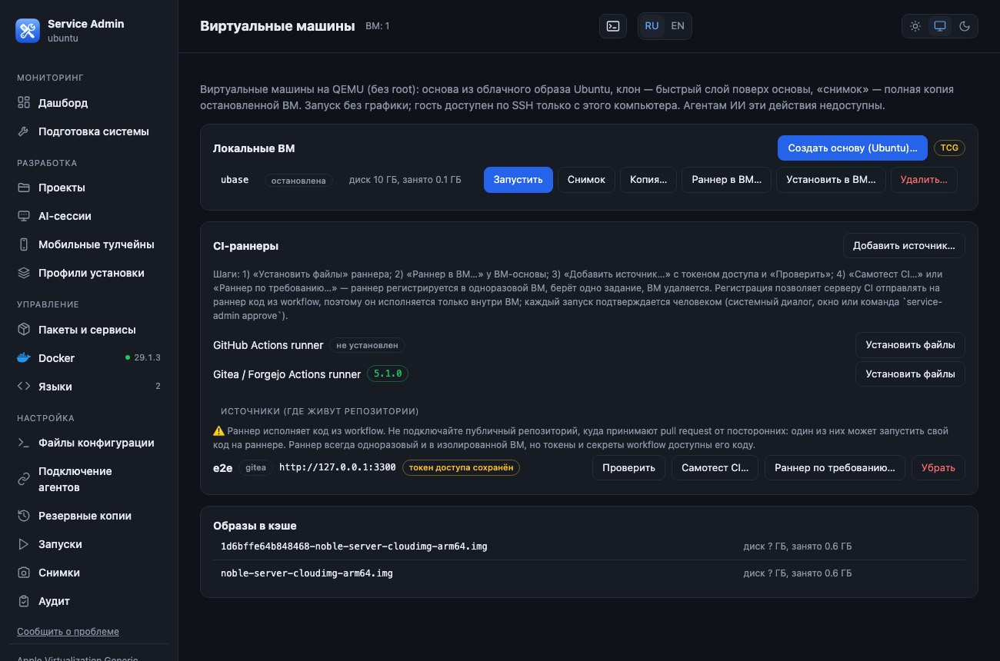

# On-demand CI runners on Linux (QEMU)

_The screenshots show the Russian interface; switch to English with the RU / EN buttons in the panel header._

The same concepts as in `ci-runners.md` (a source with an access token, a self-test, a single-job runner). **The hypervisor differs:** on Linux the panel uses **rootless QEMU**
(on macOS — tart). Tested on Ubuntu 24.04 (arm64): the base, network isolation and the **CI self-test on a temporary Gitea** — `SELFTEST PASSED`.

## What you need

* Packages: `qemu-system-arm` (arm64) or `qemu-system-x86` (x86_64), `qemu-utils`, `qemu-efi-aarch64` (arm64 only), `sshpass`, `openssh-client`. On the "Virtual machines" page there is an **"Install QEMU packages"** button.
* **KVM access:** add your user to the `kvm` group (`sudo usermod -aG kvm $USER`, then log in again). **Without KVM** the VMs run under software emulation — dozens of times slower (the **TCG** label lights up on the page); fine for a check, not for real work.
* Free space: ~4 GB for the image and the base.

## Steps

1. **"Create a base (Ubuntu)…"** — the panel downloads the official Ubuntu cloud image (verifying sha256), configures the guest through cloud-init (without network!) and shuts it down. Login to the guest is **by key**, there is no password, and the guest's host key is pinned.
2. **"Install into the VM…"** (recipes): `node` (downloaded on the host, the guest needs no internet), `build` (build-essential via apt — the **only** recipe where the guest gets internet access).
3. Then the same as on macOS: **"Install files"** for the runner (Linux builds of `gitea-runner` and `actions/runner`), **"Runner into VM…"**, **"Add source…"** with a token, **"Test"**, **"CI self-test…"** or **"On-demand runner…"**.

## Network isolation — stricter than on macOS

The runner's guest sees **neither the internet, nor your local network, nor the computer itself** (address `10.0.2.2`): **one address is reachable — the CI server** (the panel forwards it to 10.0.2.100).
Consequences: workflows that need the internet (`actions/checkout` from an external address, `npm install`, `apt`) will not work in this mode — prepare what you need in the **base** (the `build` recipe, your own packages) or
use a mirror on the CI server itself. There is **no** "without isolation" mode for runners on Linux (otherwise the guest could reach the panel API on 127.0.0.1).

## Security in a nutshell

* The runner is disposable (`--ephemeral`), and the VM is always deleted; the token goes into a guest file via stdin and is stripped from the output.
* **Do not connect a public repository that accepts pull requests from strangers**: code from a PR will run on the runner and will see the job's secrets (but not your network).
* Starting runners by agents is allowed only at L3 and only with human approval (`connect-ai-agent-linux.md`).
