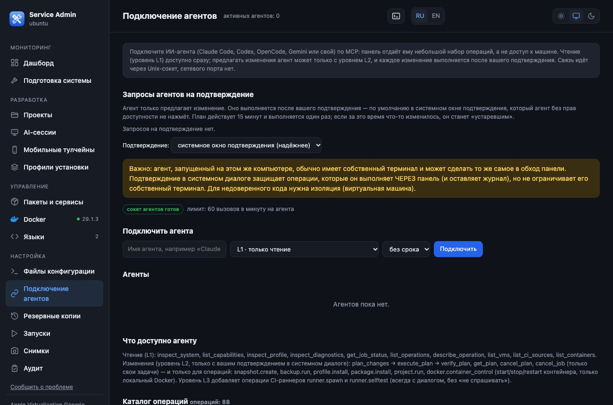

# Connecting an AI agent on Linux: how a human approves actions

The basics are the same as in `connect-ai-agent.md` (MCP, levels L1–L3, plans, approval, log). **Only the way of approving differs**: on macOS it is a system dialog,
while on Linux there may be no dialog (a headless server). Tested on Ubuntu 24.04 (headless).

> **The main rule:** the agent runs as the same user and can write to your terminal, so approval is protected by a **code that only you can see**.
> An agent that has the administrator password or passwordless `sudo` can always approve on your behalf; in that case the channel is disabled (see below).



## Approval channels

| Channel | When | What it looks like |
|---|---|---|
| **A. On-screen window** | there is a graphical session and `zenity`/`kdialog` | an "Approve / Reject" window (the default is "Reject"; 110 s = refusal) |
| **B. Root helper** | headless server | in **your own** terminal you run `service-admin approve`, enter the administrator password, see the plan text and **type the code shown** |
| — | neither of the two, or the channel is unsafe | agent plans are **not executed** (`plan.no_approval_channel`) — "better to refuse" |

If there is a display but it is "weak" (X11, or the user is in the `input` group — the agent can synthesize key presses) and the helper is installed, the helper is used.

## Installing the helper (channel B, once, as root)

The helper is a small script that **runs as root**, so install it from a directory that is **not writable by your user**
(the `.deb` package puts the sources in `/opt/service-admin` — that works; for an installation from `~/.service-admin/app` the installer refuses):

```bash
sudo /opt/service-admin/install-approver.sh your_user
# or from your own copy: sudo cp -r ~/.service-admin/app /opt/service-admin-src && sudo /opt/service-admin-src/install-approver.sh your_user
```

It installs `/usr/local/libexec/service-admin-approve`, a polkit action (password **every time**) and a sudoers entry (`timestamp_timeout=0`), and creates the decisions directory `/var/lib/service-admin/approvals/<uid>` (owned by root).

## How to approve a plan

1. The agent proposes a change (`plan_changes`), and a request appears in the panel ("AI access → Approval requests").
2. In **your own** terminal: `service-admin approve` (if there are several requests, specify the id). Fallback if the polkit agent is unavailable: `service-admin approve --sudo`.
3. Enter the administrator password, read the text — it is the same text as in the panel — and type the **four-character code** shown on the screen. Any other input = refusal.
4. The panel accepts the decision only if the decision file was **created by root**, is not writable by others, and matches the request by number, one-time code and expiry time.

## When the channel is disabled automatically

* the user has **passwordless `sudo`** (`NOPASSWD`) — the agent could approve on its own;
* the user is in "root-equivalent" groups: `docker`, `lxd`, `incus`, `incus-admin`, `libvirt`, `disk`;
* a polkit rule that grants `YES` without a password.

`GET /api/platform` shows the channel state and the reasons.

## What remains a risk (honestly)

* An agent that can **modify the panel's own code** (it belongs to your user) or inject into its process bypasses any checks of the panel. The protection against this is to run the agent as a **different** user or in a VM.
* The agent can write to your terminal — that is why a code is needed, not just "y".
* On X11 any client can press buttons in windows; for servers and "strict" mode use channel B.
* Call `pkexec /usr/local/libexec/service-admin-approve <id>` directly from a trusted terminal if you do not trust the shell and the `service-admin` in your directory.
