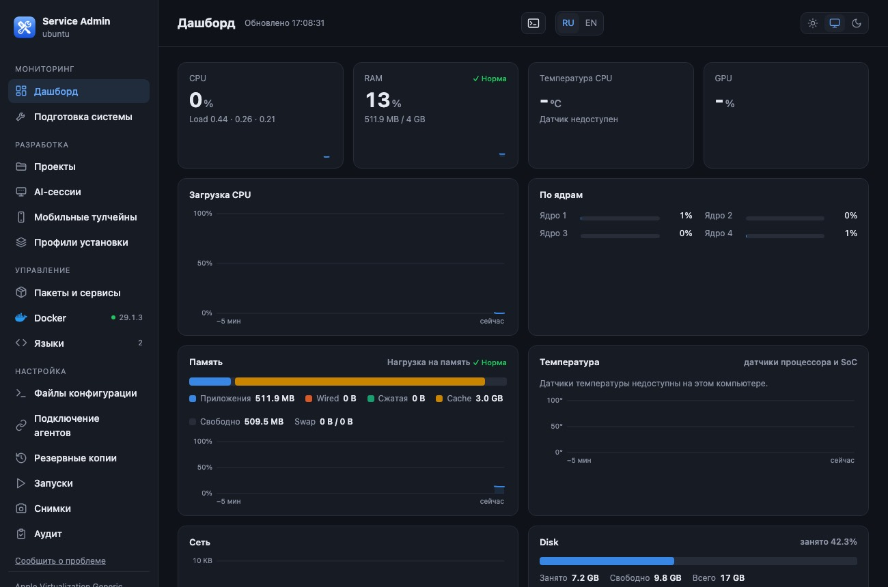
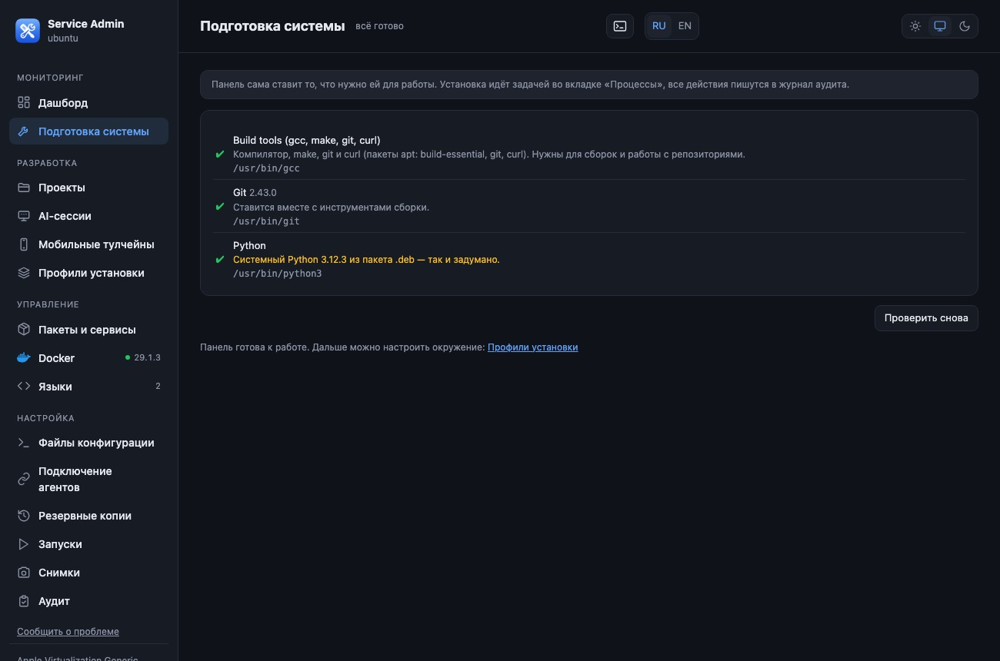
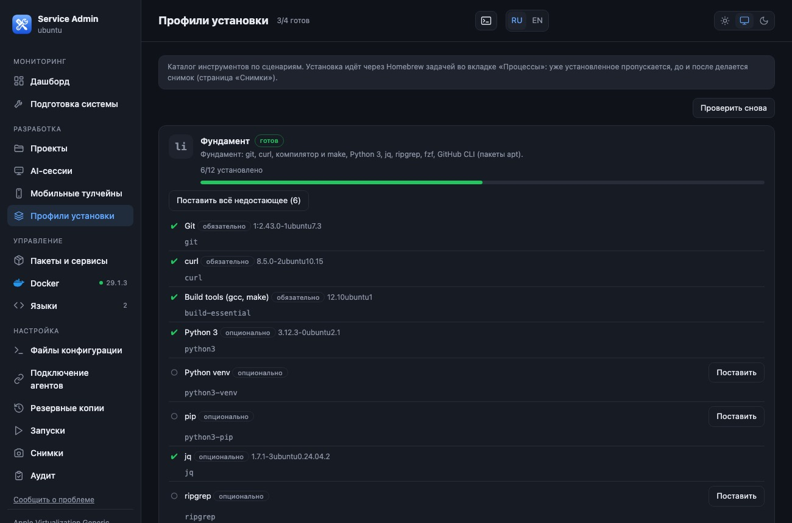
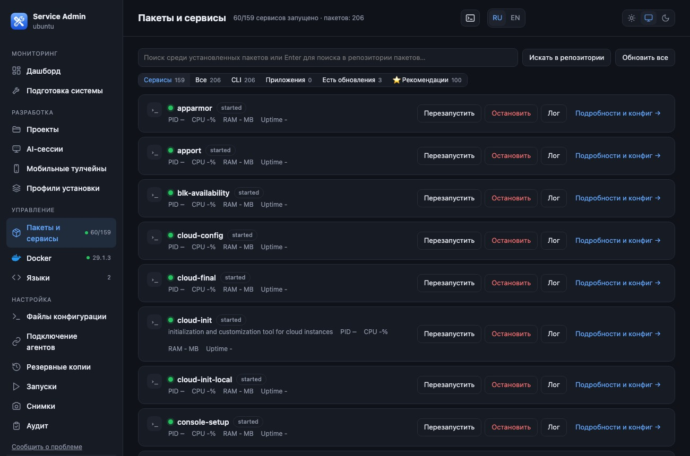
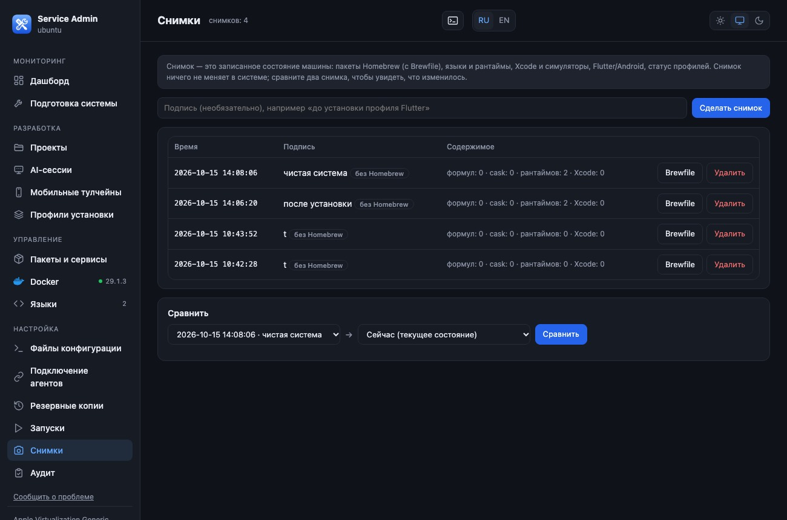
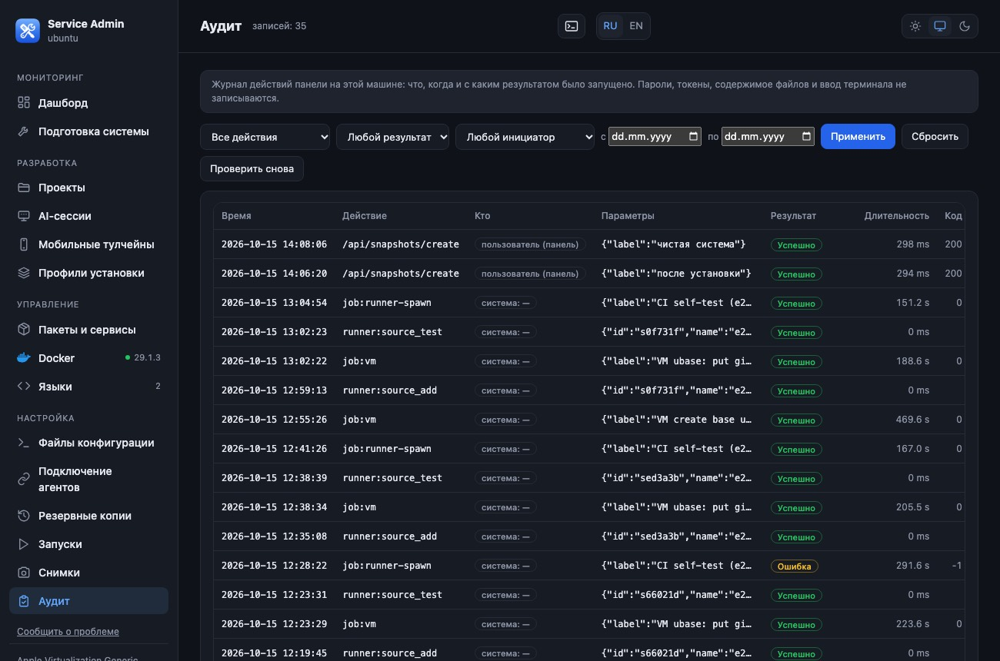

# Installing Service Admin on Linux (with screenshots)

_The screenshots show the Russian interface; switch to English with the RU / EN buttons in the panel header._

This guide was tested **on a real Ubuntu 24.04 (arm64) in a virtual machine**, headless (like a server). The screenshots show the panel running on that system,
captured from another computer through an SSH tunnel. The panel itself is in Russian by default; the language is switched with the **RU / EN** buttons in the header.

**What you get:** the panel at `http://127.0.0.1:8765` (reachable only from this computer) and a user systemd service that starts at boot.

**Requirements:** Ubuntu 22.04 / 24.04 or Debian 12+, arm64 or x86_64, `curl`, `tar`, `openssh-client`; **root is not needed** for the panel itself
(root is only needed to install apt packages and for the optional "approval helper", see below).

---

## Option 1. One command (recommended)

```bash
curl -fsSL https://raw.githubusercontent.com/LavTeamProject/DevBoxAdmin/main/get.sh | bash
```

The script downloads the sources into `~/.service-admin/app` and **its own Python 3.12** (with checksum verification, so the system Python is not needed and Ubuntu 22.04 works too),
installs the `service-admin.service` unit (systemd, user) and enables `linger` (start at boot without logging in). Running it again = update.
To pin a version: `SA_REF=<tag or commit> SA_SHA256=<checksum>` before `bash`.

## Option 2. The .deb package

For Ubuntu 24.04 / Debian 13 (system Python 3.11+). The sources live in `/opt/service-admin`, owned by root (this is safer for the "approval helper").

```bash
sudo apt install ./service-admin_0.1.0_all.deb
service-admin-setup        # a service for YOUR user on the system Python
```

To build the package yourself: `packaging/deb/build.sh` (requires `dpkg-deb`).

## Open the panel

* **With a display:** open `http://127.0.0.1:8765` in a browser (or use the "Service Admin" shortcut in the application menu).
* **Headless server:** from your computer, forward the port and open the address locally:
  ```bash
  ssh -N -L 8765:127.0.0.1:8765 user@server
  ```
  The panel **does not listen on the network**, only on `127.0.0.1`; remote access is possible only through an SSH tunnel.



---

## Step 1. "System setup"

The panel shows what is missing: a compiler, `make`, `git`, `curl`. The **"Install"** button:

* **with a display** — a system authorization window (polkit) asks for the administrator password, and the packages `build-essential git curl` are installed as a task (the "Processes" tab);
* **headless** — the panel **does not accept a password**: it opens the "Terminal" tab with a ready-made command `sudo /usr/bin/apt-get install -y build-essential git curl`;
  you type the password in the terminal yourself (the panel never sees it).



## Step 2. Profiles, packages, services

* **Install Profiles** — sets of tools: "Foundation" (git, curl, compiler, Python, jq, ripgrep, fzf, gh…), Backend, Flutter, Containers (Docker). A profile is installed with **a single apt command**; a snapshot is taken before and after.
* **Packages & services** — systemd services (user and system), apt packages, search, recommendations. System services and package installation require administrator rights (same flow: a polkit window or the terminal).
* ⚠️ The "Containers" profile installs Docker: **membership of the user in the `docker` group is equivalent to root access**, so the agent approval channel is disabled (see `connect-ai-agent-linux.md`).





## Step 3. Snapshots and audit

**Snapshots** record the installed apt packages and language versions (before and after any change, for comparison). **Audit** is a log of everything the panel did,
showing **who** initiated it (user / agent / system). Secrets never end up in the log.





---

## Next

* Connect an AI agent: `connect-ai-agent-linux.md`.
* Disposable CI runners in virtual machines: `ci-runners-linux.md`.

## Uninstalling

```bash
~/.service-admin/app/uninstall-linux.sh      # option 1  (or /opt/service-admin/uninstall-linux.sh for .deb)
rm -rf ~/.service-admin                      # data (optional)
```

## If something went wrong

| Symptom | What to do |
|---|---|
| `curl … 404` | the repository is not published yet or is private; download the archive manually and run `./install-linux.sh` |
| "user systemd is unavailable" | the session has no user bus: log in over ssh again or run `sudo loginctl enable-linger $USER`; fallback mode — the server runs in the background without autostart |
| port 8765 is busy | `ss -ltnp \| grep 8765`; another port: `python3 server.py --port 8766` |
| the page is empty through the tunnel | check that the tunnel points to `127.0.0.1:8765` and that the browser address is `http://127.0.0.1:…` (the panel checks the Host header) |
| service log | `journalctl --user -u service-admin -n 100` or `~/.service-admin/logs/server.err` |
