# Установка Service Admin на чистый Mac (со скриншотами)

Руководство проверено **на настоящей чистой macOS 26.6 в виртуальной машине** (образ `macos-tahoe-vanilla`: без Command Line Tools,
Homebrew, Git, Python — ровно «только что установленная система»). Все скриншоты сняты там же. Установщик в ВМ шёл на английском (по `LANG`
гостя); у вас он будет на русском, если системный язык не английский (принудительно: `SA_LANG=ru` / `SA_LANG=en`).

**Что получится:** приложение «Service Admin» в «Программах», сервер панели, который стартует при входе в систему, и панель в браузере по адресу
`http://127.0.0.1:8765` (доступна только с этого Mac).

**Нужно:** Mac на Apple Silicon, macOS 13 или новее, доступ в интернет, около 100 МБ свободного места (встроенный Python занимает ~70 МБ). Права администратора на этом этапе **не нужны**.
Для следующих шагов (Command Line Tools и Homebrew): **≥ 25 ГБ свободно**, если ставить через диалог Apple (иначе — через `softwareupdate`, см. шаг 4.1); **отключите VPN** на время установки, если он уводит весь трафик.

---

## Шаг 1. Положите папку проекта на Mac

На чистом Mac нет `git`, поэтому проще скопировать папку `mac-service-admin` (архивом, по AirDrop, с флешки) в домашнюю папку, например в
`~/service-admin`. Если у вас уже есть Command Line Tools и `git`, подойдёт и `git clone`.

> Папка должна лежать **вне** `~/Documents`, `~/Desktop` и `~/Downloads`: иначе при первом запуске macOS попросит разрешение на доступ к этим
> папкам (ничего страшного — нажмите «Разрешить», но проще избежать).

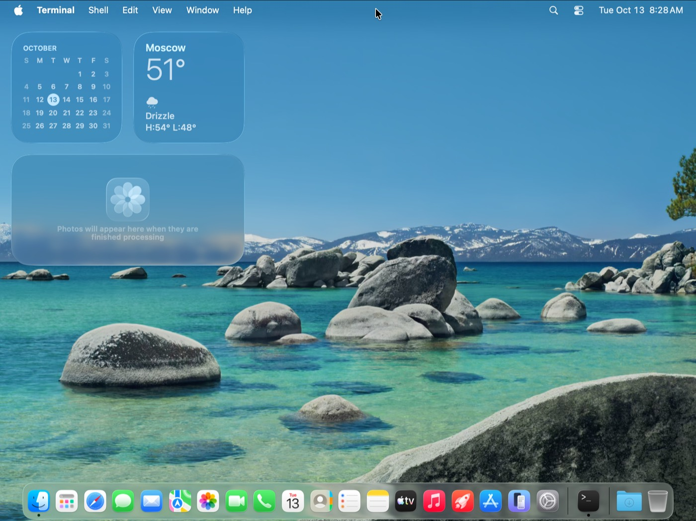

---

## Шаг 2. Откройте Terminal и запустите установщик

1. Нажмите **⌘ Пробел**, введите `Terminal`, нажмите Enter.
2. Выполните:
   ```bash
   cd ~/service-admin
   ./install.sh
   ```
3. Установщик **сам** делает всё нужное (подробный вывод ниже), ничего не спрашивает и ничего не ставит из Homebrew:
   * скачивает собственный **Python 3.12** (python-build-standalone) в `~/.service-admin/runtime/python`, **проверяет контрольную сумму** и распаковывает.
     Системный Python не нужен — на чистом Mac его всё равно нет;
   * собирает приложение-лаунчер средствами macOS (`osacompile`);
   * кладёт `Service Admin.app` в `/Applications` (или в `~/Applications`, если у вас нет прав на запись);
   * устанавливает автозапуск сервера при входе (LaunchAgent `local.service-admin`);
   * запускает сервер и проверяет, что он отвечает.

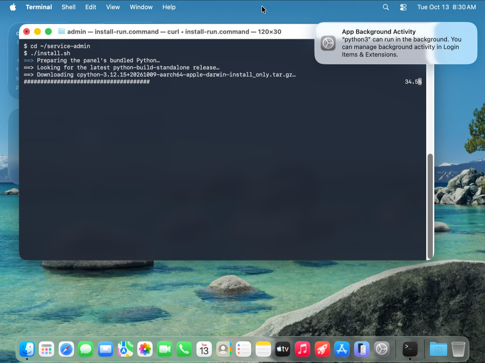

В конце — строка «Готово / Done». Сервер уже работает на `http://127.0.0.1:8765`.

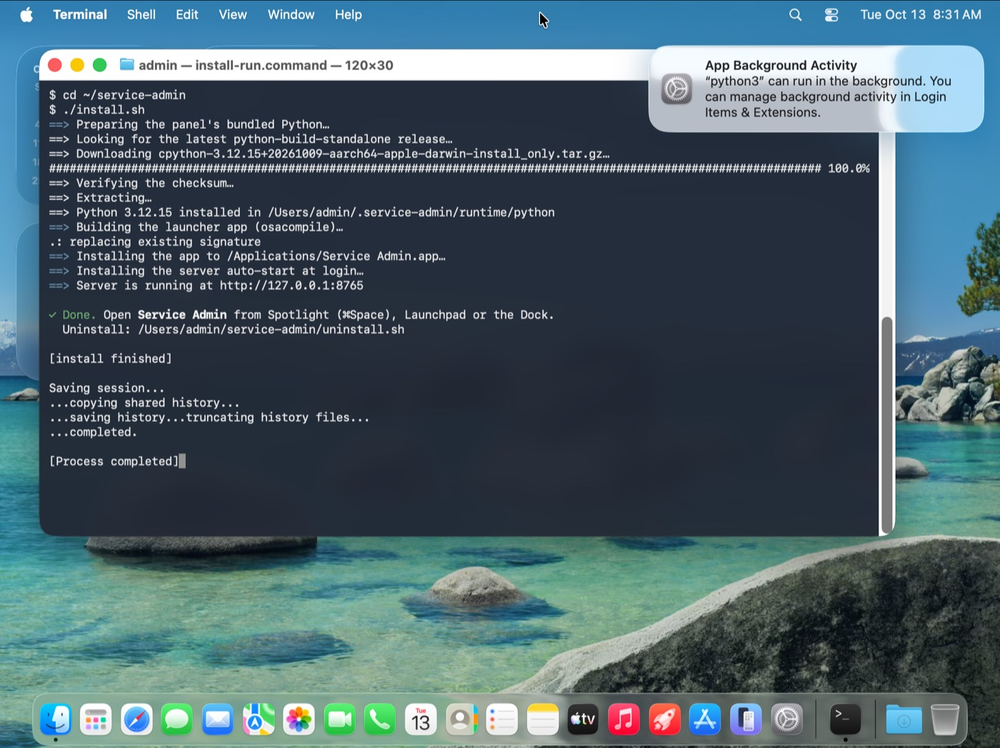

**Уведомление macOS «App Background Activity — python3 can run in the background»** — это нормально: macOS сообщает, что появился фоновый процесс
(сервер панели). Ничего нажимать не нужно. Управлять им можно в **Системные настройки → Основные → Объекты входа и расширения**.

Если сервер «пока не отвечает» и появился диалог «Python хочет получить доступ к папке…» — нажмите **«Разрешить»**: сервер продолжит сам.

---

## Шаг 3. Откройте приложение «Service Admin»

Приложение лежит в «Программах» (Finder → Программы). Его можно открыть из **Spotlight** (⌘ Пробел → `Service Admin`), **Launchpad** или **Dock**
(перетащите значок на Dock, чтобы всегда был под рукой).

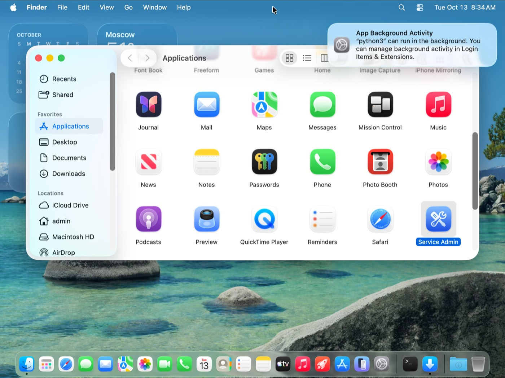

Приложение — маленький лаунчер: оно проверяет, что сервер запущен (если нет — запускает), и открывает панель в браузере.


Можно и сразу в браузере: **http://127.0.0.1:8765**. Язык переключается кнопками **RU / EN** в шапке, тема — справа (светлая / авто / тёмная).

---

## Шаг 4. «Подготовка системы»

Первая страница, на которую стоит зайти. Панель сама показывает, чего не хватает **этому** Mac, и ставит это (все действия видны на вкладке «Процессы» и
пишутся в журнал «Аудит»).

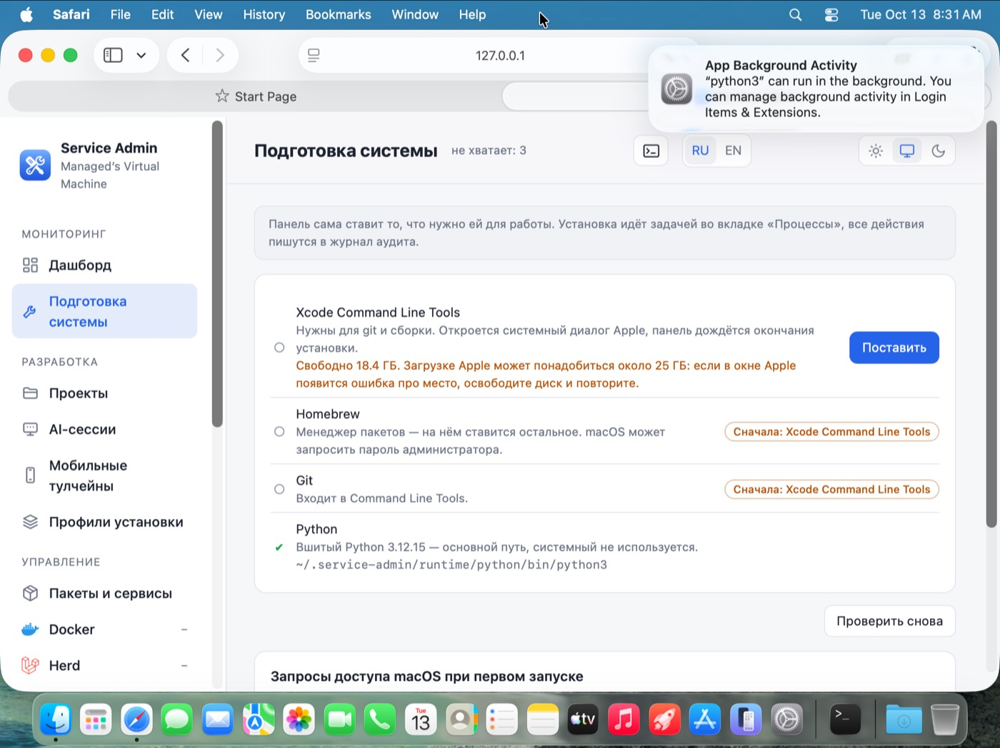

| Пункт | Что это | Как ставится |
|---|---|---|
| **Python** | встроенный Python панели | уже установлен на шаге 2 (галочка) |
| **Xcode Command Line Tools** | git и инструменты сборки | кнопка **«Поставить»** → системный диалог Apple (ниже) |
| **Homebrew** | менеджер пакетов, на нём ставится остальное | станет доступен после Command Line Tools; официальный установщик, macOS может запросить пароль администратора |
| **Git** | входит в Command Line Tools | появится после Command Line Tools |

Пока чего-то не хватает, **на каждой странице сверху появляется синий баннер** «Не хватает: … Подготовка системы →» (виден на скриншотах ниже).

### 4.1. Command Line Tools

Нажмите **«Поставить»**: панель вызовет `xcode-select --install`, и macOS покажет **свой** диалог. Нажмите **Install** (и **Agree**, если спросит лицензию),
дождитесь окончания — панель ждёт сама, статус виден в «Процессах».

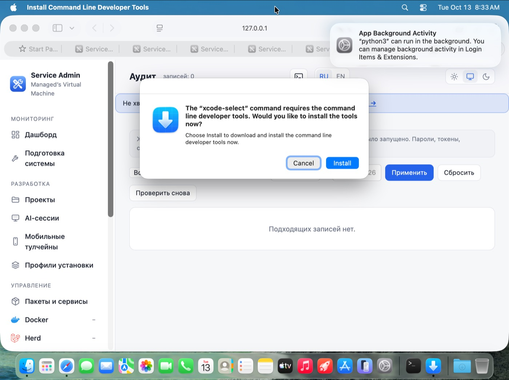

**Проверено на настоящей системе — два типичных препятствия:**

1. **«Can’t download the software because of a network problem».** Если на Mac включён **VPN** с маршрутом по умолчанию, у виртуальной машины (и у
   некоторых окружений) нет интернета; на реальном Mac такая ошибка бывает при блокировке серверов Apple. Отключите VPN и повторите.
2. **«Can’t install the software because there is not enough disk space. 24.27 GB is needed but only 18.49 GB is available.»** Установщик Apple требует
   **около 24 ГБ свободного места** (сам пакет — меньше 1 ГБ, но проверка Apple консервативна). Это ровно то предупреждение, которое панель показывает под пунктом.

   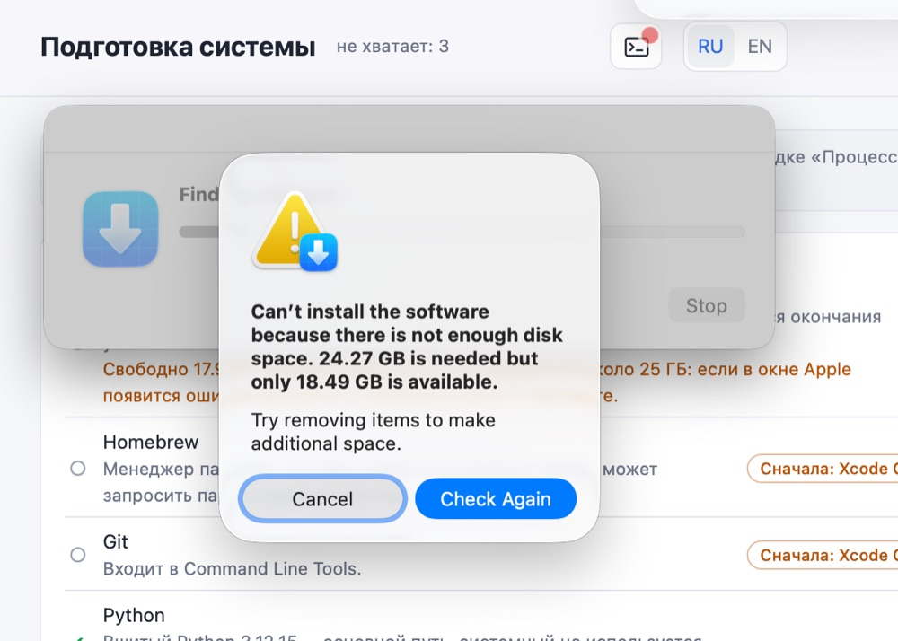

   **Что делать:** освободить место (нужно ≥ 25 ГБ) — **или** поставить Command Line Tools из Terminal через `softwareupdate` (проверка на 24 ГБ там не нужна, нужно ~1–3 ГБ;
   **потребуется пароль администратора**):
   ```bash
   sudo touch /tmp/.com.apple.dt.CommandLineTools.installondemand.in-progress
   softwareupdate -l                                   # найдите строку «Label: Command Line Tools for Xcode …»
   sudo softwareupdate -i "Command Line Tools for Xcode 26.5-26.5" --verbose   # подставьте свой Label
   sudo rm -f /tmp/.com.apple.dt.CommandLineTools.installondemand.in-progress
   ```
   В проверке на чистой ВМ это заняло около 4 минут (загрузка ~0,9 ГБ + установка). Панель сама увидит результат: пункт получит галочку после «Проверить снова».

После установки Command Line Tools **Git** и **Python** отмечены автоматически, остаётся Homebrew:

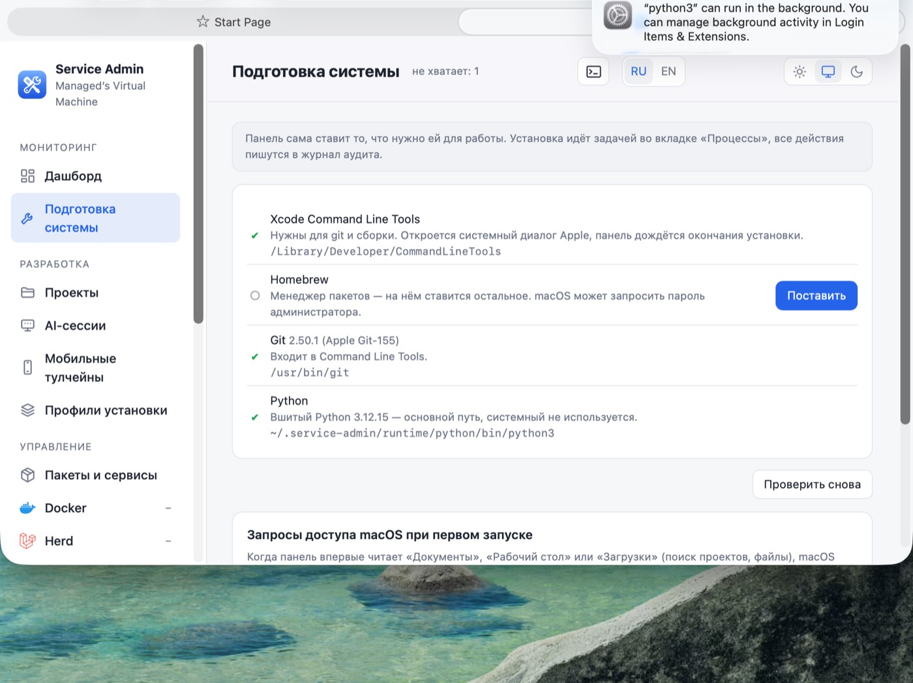

### 4.2. Homebrew

Нажмите **«Поставить»** у Homebrew. Панель скачает **официальный установщик**, покажет его контрольную сумму в журнале и запустит установку
(macOS может запросить пароль администратора — вводите его в системном диалоге macOS, панель его не видит). Ход виден на вкладке «Процессы»; в проверке на чистой ВМ
Homebrew 7.0.9 ставился около 3,5 минуты.

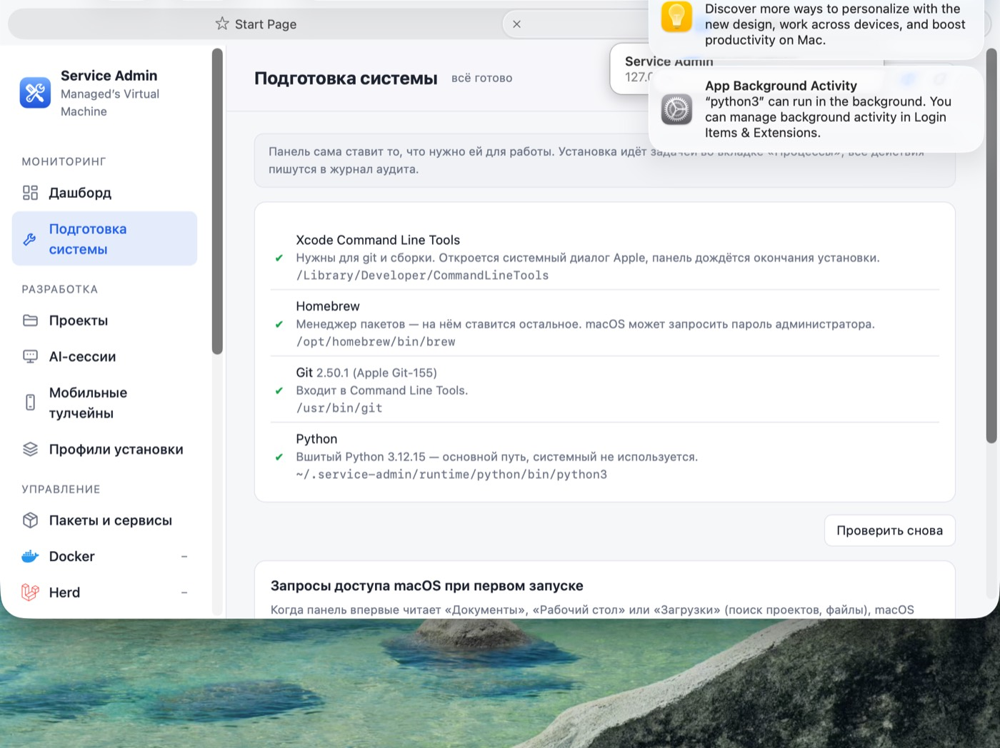

---

---

## Шаг 5. Что дальше: обзор страниц

| Страница | Для чего |
|---|---|
| **Дашборд** | нагрузка CPU/RAM, температура, диск, батарея |
| **Профили установки** | наборы инструментов (Фундамент, AI, Flutter, iOS, Backend): панель покажет, что уже есть, и поставит недостающее |
| **Подключение агентов** | ИИ-агенты (Claude Code, Codex…) по MCP: регистрация, уровни L1–L3, очередь подтверждений |
| **Виртуальные машины** | tart, одноразовые ВМ и CI-раннеры (**tart не обязателен** — без него страница так и пишет «tart не найден») |
| **Резервные копии** | git-репозитории и данные в локальную папку или на внешний диск |
| **Аудит** | журнал всего, что делала панель (без паролей и токенов) |

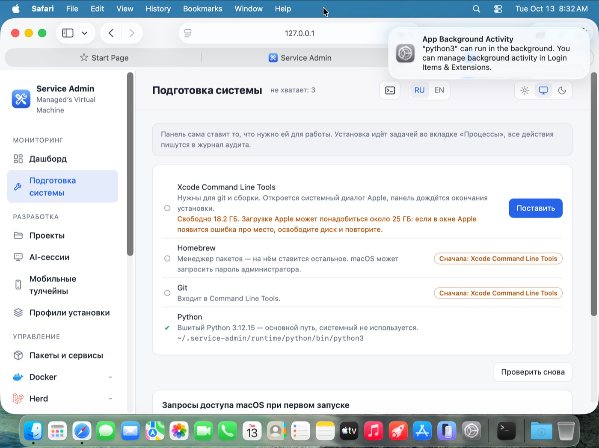

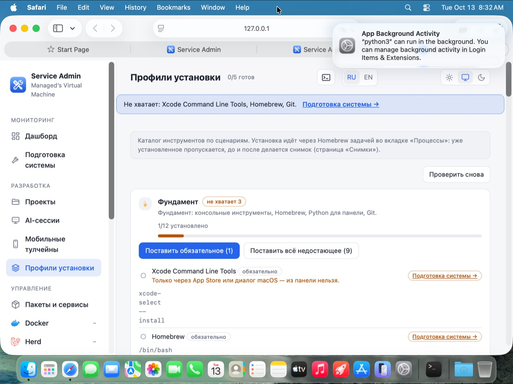

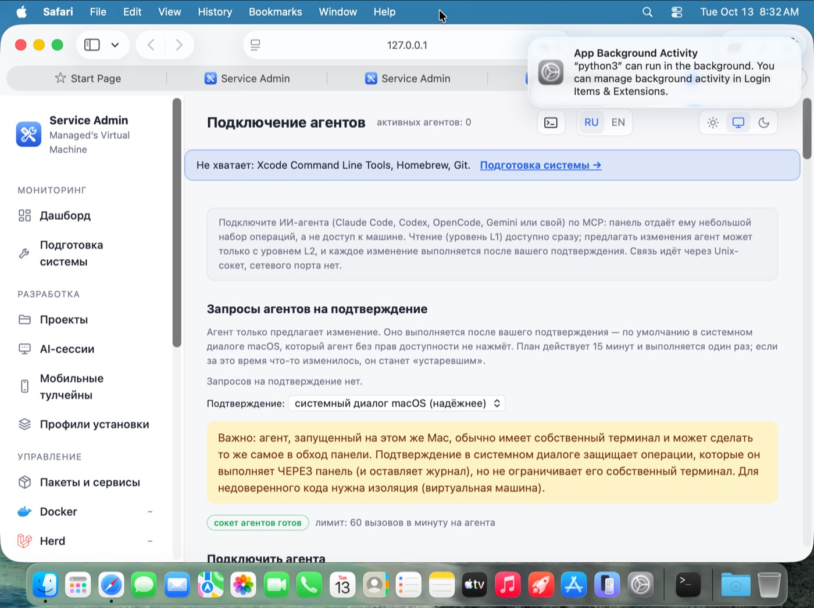

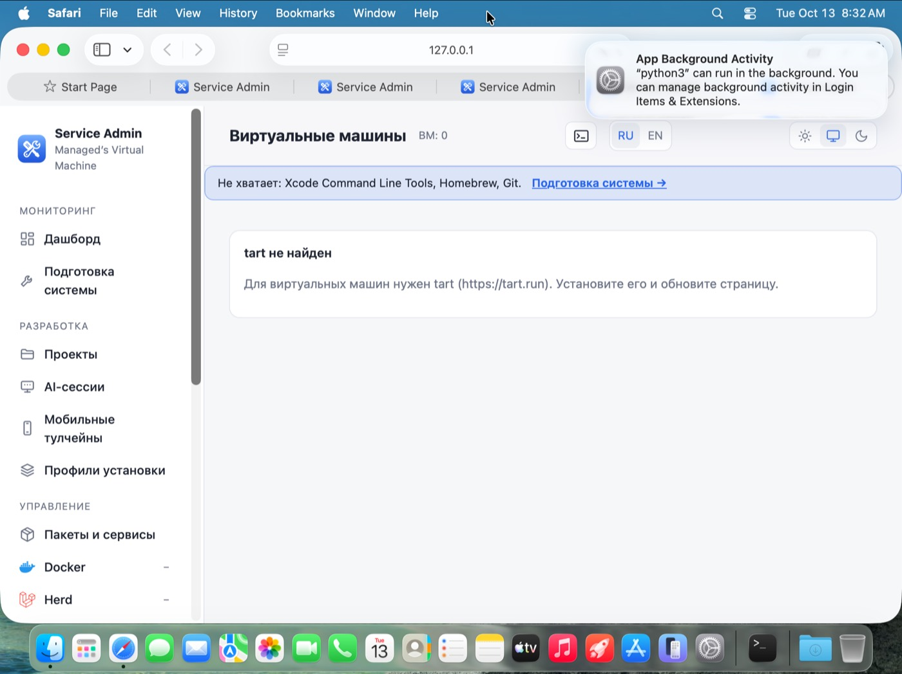

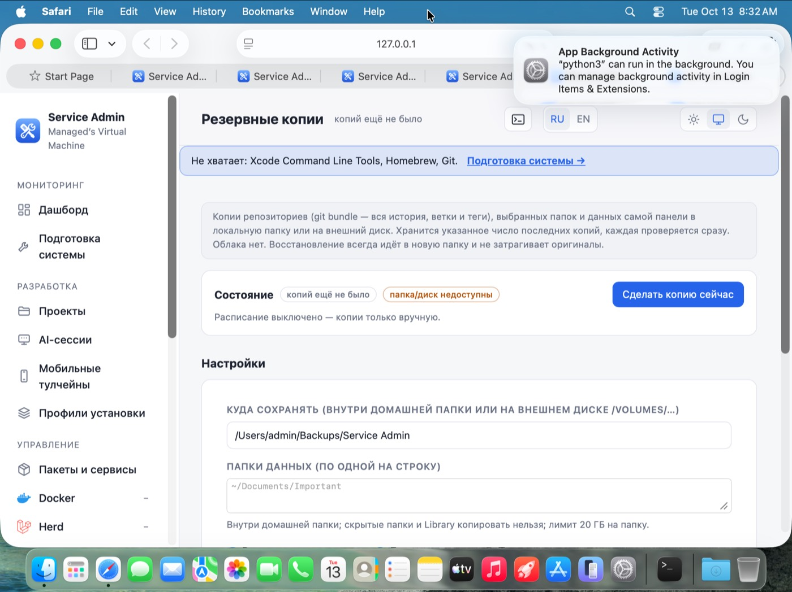

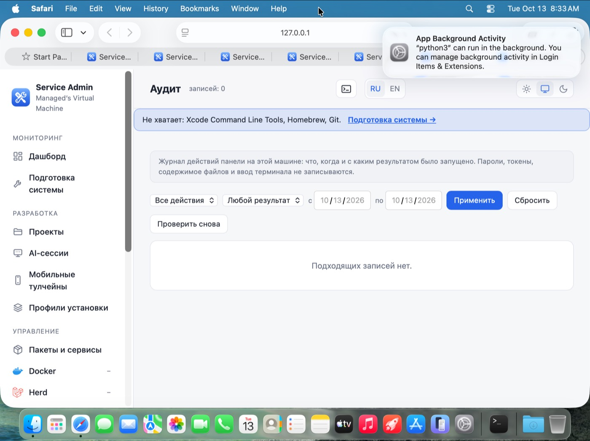

### 5.1. Профили установки (проверено на чистой ВМ)

Страница **«Профили установки»** показывает наборы инструментов и что из них уже есть. Нажмите **«Поставить всё недостающее»** у профиля — панель сама поставит недостающее через Homebrew,
**до и после сделает снимок** состояния машины и покажет результат. В проверке профиль **«Фундамент»** (8 недостающих инструментов: Python 3.12, gh, fzf, yq, ripgrep, lazygit, lazydocker, git-delta)
поставился примерно за 2,5 минуты; после него «12/12 установлено».

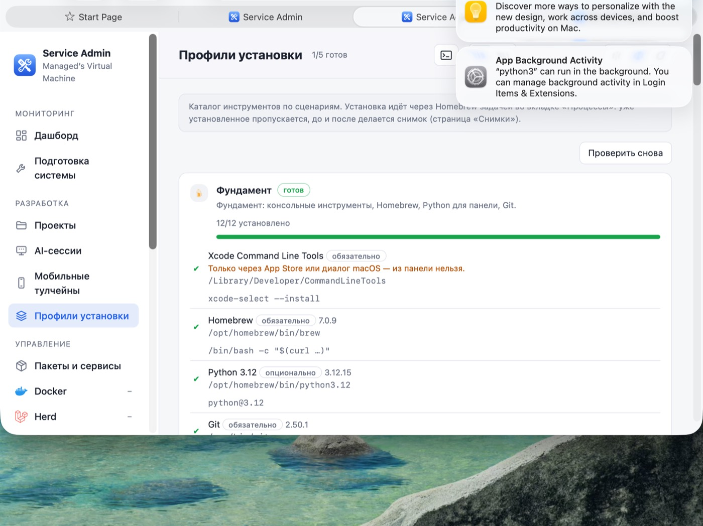

На странице **«Снимки»** остались два снимка — «до» и «после» (формул Homebrew: 0 → 20); их можно сравнить, чтобы увидеть, что именно изменилось. Снимок ничего не меняет в системе.

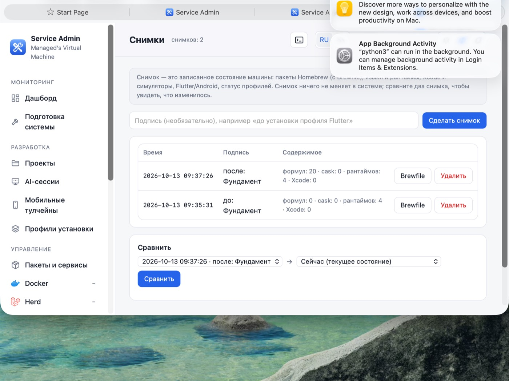

Дальше:
* подключить ИИ-агента — `manuals/connect-ai-agent.md`;
* запускать CI-раннеры в одноразовых ВМ — `manuals/ci-runners.md`.

---

## Если что-то пошло не так

| Симптом | Что делать |
|---|---|
| `./install.sh`: «Permission denied» | `chmod +x install.sh uninstall.sh fetch-python.sh` и повторите |
| установщик: «не удалось связаться с GitHub API» / «скачивание не удалось» | нет интернета или он ограничен (VPN/прокси); повторите — установка идемпотентна |
| «контрольная сумма не совпала» | загрузка повредилась; повторите. Установка **останавливается** и ничего не ставит с неверной суммой |
| приложение пишет, что сервер не отвечает | откройте лог `~/.service-admin/logs/server.err`; при диалоге про доступ к папке — «Разрешить» |
| порт 8765 занят | `lsof -i tcp:8765`; панель можно запустить на другом порту: `~/.service-admin/runtime/python/bin/python3 server.py --port 8766` |
| Apple: «not enough disk space. 24.27 GB is needed…» | освободите ≥ 25 ГБ или поставьте Command Line Tools через `softwareupdate` (шаг 4.1) |
| Apple: «Can’t download the software because of a network problem» | отключите VPN (в виртуальных машинах из-за VPN нет интернета), проверьте сеть и повторите |

## Обновление и удаление

* **Обновить:** замените папку проекта новой версией и снова выполните `./install.sh` — он идемпотентен (пересоберёт приложение, перезапустит сервер, не тронет данные).
* **Удалить:** `./uninstall.sh` — снимает автозапуск и удаляет приложение. **Данные** (`~/.service-admin`: снимки, копии, журнал, токены агентов) остаются; удалите вручную, если не нужны:
  ```bash
  rm -rf ~/.service-admin
  ```

---

*Как сделан этот документ:* на чистой ВМ выполнены именно эти шаги; скриншоты — окно ВМ, снятое с хоста. Что в ВМ проверить нельзя (диалог пароля администратора, установка CLT при нехватке места) —
помечено в тексте и в `docs/unverified.md`.
